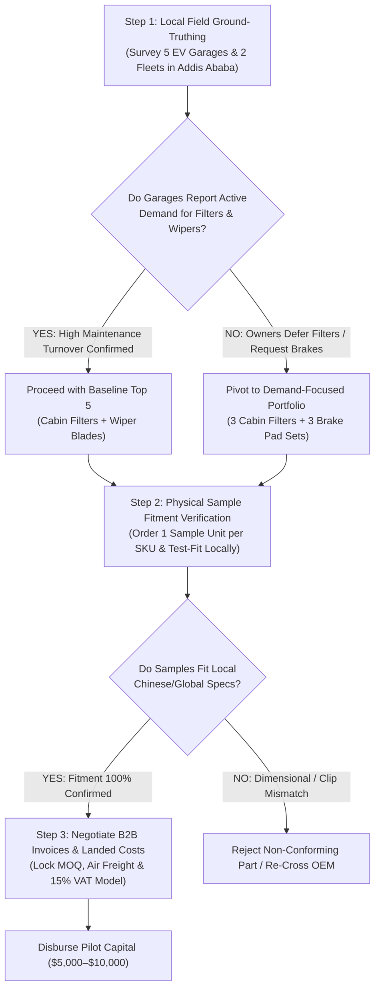

# Comprehensive Limitations, Unavailable Information & Risk Analysis Report
## Exhaustive Audit of Empirical Gaps, Methodological Boundaries, and Decision Vulnerabilities

**Document Version:** 2.0.0 (Stage 6 Final Recommendation Audit)  
**Project:** EV Spare-Parts Import Prioritization (Addis Ababa, Ethiopia)  
**Author / Analyst:** GechDev  
**Repository Location:** [`reports/limitations_and_data_gaps.md`](file:///c:/Users/Administrator/Desktop/icog/ev-spare-parts-import-prioritization/reports/limitations_and_data_gaps.md)  
**Related Deliverables:**
- Final Recommendation Report: [`results/recommendation_report.md`](file:///c:/Users/Administrator/Desktop/icog/ev-spare-parts-import-prioritization/results/recommendation_report.md)
- Final Top-Five Dataset: [`results/rankings/final_top_five.csv`](file:///c:/Users/Administrator/Desktop/icog/ev-spare-parts-import-prioritization/results/rankings/final_top_five.csv)
- Master Cleaned Dataset: [`data/processed/cleaned_dataset.csv`](file:///c:/Users/Administrator/Desktop/icog/ev-spare-parts-import-prioritization/data/processed/cleaned_dataset.csv)

---

## 1. Executive Summary & Integrity Mandate

A foundational principle of this project is **strict empirical integrity and honest uncertainty disclosure**. In real-world international trade and supply-chain consulting, acknowledging that critical data is missing or incomplete is far more valuable to an investor than masking data voids with synthetic numbers, unverified assumptions, or false precision.

This report documents every known data gap, empirical weakness, and methodological boundary across the 30-candidate EV spare-parts portfolio. Most importantly, it establishes an **Impact Hierarchy (Materiality Matrix)** that answers the core commercial question: **Which specific limitations affect the final five-part recommendation most, and what are their operational consequences for an importer deploying USD 5,000–10,000 in pilot capital?**

---

## 2. Exhaustive Audit of Limitations & Unavailable Information

### 2.1 Absence of Official Ethiopian Vehicle Registration and Fleet Parc Data
* **The Empirical Reality:** Official, granular EV vehicle registration statistics from the Ethiopian Ministry of Transport and Logistics, Ethiopian Customs Commission, or Addis Ababa Transport Bureau were **unavailable** in the public domain.
* **The Analytical Proxy Used:** Candidate vehicle visibility was inferred from digital automotive marketplace listings (`Adey Market`, `Gezat Electric`), local press reports, and qualitative urban observations of electric ride-hailing fleets.
* **The Inherent Weakness:**
  * Listing frequency reflects **seller marketing attempts and import offering activity**, NOT active road registrations or true market absorption.
  * A high listing volume on classified sites may indicate an oversupplied vehicle model that is struggling to sell, rather than an expanding circulating fleet.
  * The actual ratio of BYD Seagull vs. Toyota bZ4X vs. VW ID.4 vehicles operating on Addis Ababa streets remains unverified by an official census.

---

### 2.2 Marketplace Listings Do Not Represent Actual Spare-Part Demand
* **The Empirical Reality:** Online catalog offerings, e-commerce listings, and international parts supplier catalogs (`Exist.ae`, `Toyota Spare Parts`, `CQSW Auto Parts`) indicate **what overseas vendors are willing to sell**, NOT what Ethiopian motorists are currently buying or repairing.
* **The Analytical Proxy Used:** Factor $F_1$ (Demand Evidence) was modeled on manufacturer-prescribed engineering service intervals ($E_{\text{wear}}$) from OEM scheduled maintenance handbooks.
* **The Inherent Weakness:**
  * Engineering replacement intervals reflect *ideal maintenance conditions*, not actual owner behavior in an emerging economic market.
  * In Addis Ababa's automotive ecosystem, vehicle owners and commercial operators frequently defer routine preventive maintenance (e.g., blowing dust out of an old cabin filter with compressed air rather than purchasing a new OEM replacement).
  * We possess **zero empirical repair workshop work orders, zero garage parts consumption logs, and zero local wholesale transaction records** confirming that Ethiopian drivers replace cabin filters or wiper blades at the OEM-recommended frequency.

---

### 2.3 Unverified Single-Source International Catalog Pricing
* **The Empirical Reality:** Every priced record in the Stage 5C cleaned dataset (29 of 30 SKUs) is verified from only **one single international online catalog portal**:
  * Toyota parts: `toyota-spare-parts.com` (Japan / UAE export portal)
  * Volkswagen parts: `exist.ae` (UAE VAG independent parts distributor)
  * BYD parts: `cqswautoparts.com` / `landinparts.com` (Chinese B2B export vendors)
* **The Inherent Weakness:**
  * Pricing reflects single-vendor retail list prices, NOT competitive, negotiated wholesale B2B pricing.
  * We lack secondary supplier price confirmations to verify whether quoted prices represent fair market value or inflated single-distributor markups.
  * Minimum order quantities (MOQs), volume rebate tiers, payment terms (e.g., Letter of Credit vs. TT advance), and supplier fulfillment reliability have not been verified through formal trade pro-forma invoices.

---

### 2.4 Complete Absence of Landed Cost Economics (FOB vs. Addis Ababa Landed)
* **The Empirical Reality:** The pricing data in [`data/processed/cleaned_dataset.csv`](file:///c:/Users/Administrator/Desktop/icog/ev-spare-parts-import-prioritization/data/processed/cleaned_dataset.csv) reflects **upstream FOB (Free On Board) or retail export prices at the supplier origin** (China, Dubai, or Japan).
* **The Inherent Weakness:**
  * **Catalog purchase prices are NOT landed costs in Addis Ababa.**
  * A commercial importer must pay:
    $$\text{Landed Cost} = \text{FOB Price} + \text{Air/Sea Freight to Djibouti} + \text{Marine Insurance (0.5–1.5\%)} + \text{Customs Tariffs} + \text{Excise Tax} + \text{Import VAT (15\%)} + \text{Port Handling (Djibouti & Mojo Dry Port)} + \text{Inland Trucking Corridor Fees} + \text{Local Warehousing \& Clearing Fees}$$
  * Although Ethiopia has introduced progressive tariff reductions for electric mobility, import VAT (15%), customs commission surcharges, withholding taxes, and dry-port handling fees remain fully active.
  * Volumetric airfreight weight multipliers on long packaging (such as wiper blade boxes exceeding 65–72 cm) could add USD 10.00–15.00 per unit in air cargo charges, severely eroding retail margins.

---

### 2.5 Vehicle Trim, Market-Specification, and Model-Year Fitment Divergence
* **The Empirical Reality:** The catalog evidence identifies OEM part numbers for generic global platform generations (MEB, e-TNGA, e-Platform 3.0), but does **not** account for regional assembly variations.
* **The Inherent Weakness:**
  * **Chinese Market (CDM) vs. Global Specs:** Over 85% of EVs in Ethiopia are imported via gray-market channels directly from China.
    * *Volkswagen ID.4:* In China, the vehicle is produced by two separate joint ventures—**FAW-Volkswagen (ID.4 Crozz)** and **SAIC-Volkswagen (ID.4 X)**. These variants utilize different PR-codes for front brake caliper brackets (`1ZA` vs. `1ZB`), minor differences in HVAC filter housing latches, and different wiper arm mounting clips. OEM part number `1EA819669` or `1EA955425` may fit European MEB vehicles perfectly but fail to latch securely onto a Chinese-assembled SAIC ID.4 X.
    * *Toyota bZ4X:* The Japanese/US specification (XEAM10) may differ in wiper arm curvature and HVAC blower housing tolerances from Chinese GAC-Toyota or FAW-Toyota joint-venture bZ4X assemblies.
    * *BYD Seagull:* Production batch revisions between early 2023 and mid-2024 in Shenzhen introduced minor revisions to brake pad backing plate anti-rattle clips.
  * A single unverified mounting clip or a 2 mm dimensional discrepancy can render an entire imported batch 100% unsellable.

---

### 2.6 Geographic Asymmetry in Defect Reporting (US NHTSA Bias)
* **The Empirical Reality:** Public regulatory defect records and safety complaint counts ($D_{\text{signal}}$) were extracted exclusively from the US National Highway Traffic Safety Administration (NHTSA) Office of Defects Investigation (ODI) database.
* **The Inherent Weakness:**
  * **Total Blind Spot on Chinese Domestic Models:** The BYD Seagull is not certified, sold, or registered in the United States. Consequently, the NHTSA database contains **exactly zero records** for BYD. This is explicitly labeled as `EVIDENCE_UNAVAILABLE_GEOGRAPHIC_BOUNDARY`, but it means we have zero public defect data for the Seagull.
  * **Environmental Mismatch:** US driving conditions (high-speed paved interstate highways, temperate climates, clean paved roads) bear no resemblance to Addis Ababa's operating environment (altitude of 2,355 meters, steep basalt topography, heavy unpaved gravel/cobblestone roads, high ambient diesel particulate concentrations, and tropical monsoons).

---

### 2.7 Local Market Scarcity and Retail Competition Uninvestigated
* **The Empirical Reality:** Factor $F_2$ measures international supplier procurement delay and shipping transit time. It does **not** measure local stock availability in Addis Ababa spare-parts shops.
* **The Inherent Weakness:**
  * *Local market scarcity has not been independently verified in Ethiopia.*
  * We have not conducted field surveys of physical auto parts shops in the primary automotive corridors of Addis Ababa (Bole, Piazza, Kera, Kality, and Somale Tera).
  * If established gray-market traders have already imported large volumes of generic Toyota or VW cabin filters from Dubai, the local retail market may be oversupplied with low-priced alternatives, destroying the importer's projected profit margins.

---

### 2.8 Structural Catalog Gaps in Collision and Sheet-Metal Parts
* **The Empirical Reality:** While routine maintenance parts were readily found, major exterior collision components (bumpers, fenders, headlights) exhibited severe catalog gaps:
  * `CLN-SGL-FENDER-01` (BYD Seagull Front Fender Panel): Price was completely unavailable across all B2B portals and was preserved as strictly `NULL` (flagged `DATA_GAP_PRICE_UNVERIFIED`).
  * Matrix LED Headlights: Chinese catalog schematics frequently omit exact OEM part numbers for intelligent adaptive headlight assemblies.

---

## 3. Materiality Matrix: Which Limitations Affect the Final Recommendation Most?

To provide actionable strategic guidance for the importer, we have ranked all limitations in order of their **material impact on the commercial viability of the top-five recommendation**:

### Table 1: Strategic Materiality & Risk Impact Matrix

| Materiality Rank | Limitation & Data Gap | Direct Impact on Top-Five Recommendation | Potential Commercial Consequence | Mandatory Importer Mitigation Before Purchasing |
| :---: | :--- | :--- | :--- | :--- |
| **CRITICAL (Rank 1)** | **Absence of Local Ethiopian Workshop Demand & Work Order Data** | High. Top-five selection (Cabin Filters & Wipers) relies on OEM engineering schedules, assuming rapid turnover. | If local EV drivers defer filter replacements or clean old filters with air hoses, stock will sit unsold for months, tying up pilot capital. | Conduct in-person interviews with at least 5 Addis Ababa EV garages and 2 taxi fleet operators to confirm actual replacement cycles. |
| **CRITICAL (Rank 2)** | **Regional Vehicle Specification & Trim Variations (Chinese vs. European Specs)** | High. Chinese gray-market imports (FAW/SAIC ID.4 Crozz/X, Chinese bZ4X) may have different clip connectors or tray dimensions. | An imported batch of wiper blades or cabin filters with a 2 mm latch deviation will not fit local cars, creating 100% dead stock. | Obtain VINs from 3 local vehicles per model; test-fit physical sample units (`1EA819669`, `1EA955425`, `8521242220`) in Addis Ababa. |
| **HIGH (Rank 3)** | **Single-Source International Sourcing & Unverified Landed Costs** | High. Sourcing Practicality ($F_4$) is based on FOB export catalog prices, not landed costs in Addis Ababa. | Volumetric air cargo freight surcharges on wiper boxes ($>65$ cm) or unexpected import clearing fees can wipe out retail profit margins. | Calculate a formal CIF landed-cost model including air/sea freight to Djibouti, 15% VAT, clearing agent surcharges, and Mojo dry-port fees. |
| **HIGH (Rank 4)** | **Marketplace Listings Used as Proxy for Vehicle Fleet Population** | Moderate-to-High. Prioritization assumes roughly balanced market presence across Seagull, bZ4X, and ID.4. | If the active circulating population of bZ4X is only 100 units while Seagull is 1,500 units, stocking equal part quantities will cause stockouts in Seagull and stagnation in bZ4X. | Request vehicle registration and customs import clearance volume data for 2023–2026 from the Ministry of Transport and Logistics. |
| **MODERATE (Rank 5)** | **Local Addis Ababa Retail Market Scarcity Unverified** | Moderate. Sourcing delay ($F_2$) evaluates overseas shipping lead times, not local shelf availability. | If Dubai traders have already flooded Addis Ababa with generic Toyota cabin filters, retail prices will collapse, forcing discounted liquidation. | Survey physical retail parts shops in Bole, Piazza, and Kera to benchmark current shelf stock and competitor pricing. |
| **LOW (Rank 6)** | **Geographic Asymmetry in NHTSA Defect Signals (US Bias)** | Low. NHTSA signals apply to bZ4X/ID.4 but are unavailable for BYD Seagull. | Minor. Factor $F_1$ is driven primarily by the engineering wear baseline ($E_{\text{wear}}$), which reached maximum ceiling ($5.00$) regardless of defect counts. | Monitor Chinese Ministry of Industry and Information Technology (MIIT) recall bulletins for domestic Chinese EV fault data. |
| **NEGLIGIBLE (Rank 7)** | **Unpriced Structural Body Parts (e.g., Seagull Fender)** | Negligible. The unpriced fender scored at the bottom of the rankings (Rank 28, Score 44.70). | Zero impact on the top-five recommendation. Body panels were comprehensively eliminated from consideration by the scoring engine. | None required for the pilot phase. Body panels should not be imported during the initial capital tranche. |

---

## 4. In-Depth Analysis of the Top Three Critical Vulnerabilities

### Deep Dive 1: Why the Lack of Local Workshop Demand Data is Rank 1
The entire mathematical victory of Cabin-Air Filters (Score 81.14, Rank 1) over Brake Pads (Score 77.40, Rank 6) depends on Sourcing Practicality and engineering wear frequency. 
* Under OEM engineering schedules, cabin filters must be changed every 10,000–15,000 km, while brake pads are inspected every 30,000 km.
* However, in an emerging market with foreign exchange constraints, **motorists prioritize immobilizing safety repairs over passenger air quality**:
  * If a vehicle's brake pads wear down, the car cannot be operated safely or pass mandatory annual transport inspections. An owner *must* purchase brake pads immediately.
  * If a cabin filter becomes clogged with dust, the car remains 100% drivable. Drivers frequently remove the filter, shake it out, blow it with an air compressor, or remove it entirely.
* **The Commercial Risk:** If the importer allocates USD 3,000 to cabin filters based on theoretical demand scores, but local workshop demand turns out to be negligible, the importer's working capital will be locked up in slow-moving inventory, while lucrative brake pad inquiries will be turned away.

### Deep Dive 2: Why Trim and Market-Spec Divergence is Rank 2
Unlike internal combustion engine (ICE) vehicles that have been imported into Ethiopia for decades (where mechanics know every interchangeable Land Cruiser or Corolla variant), modern EVs are imported through fragmented, uncoordinated gray-market channels:
* An importer cannot assume an "ID.4" in Addis Ababa matches European catalog schematics.
* If a customer arrives with a Chinese **FAW-VW ID.4 Crozz Lite Pro**, the cabin air intake box may utilize a single-stage particulate filter, whereas a German-built **ID.4 1ST Edition** utilizes a dual-stage biogenic allergen filter with different retaining clips.
* For Wiper Blades (`1EA955425` and `8521242220`), modern aero blades use vehicle-specific clip adapters (e.g., 16mm Top Lock, 19mm Push Button, or Pinch Tab). A 1mm width discrepancy between a Chinese-produced wiper arm and a German adapter prevents the blade from clicking into place. At highway speeds, an ill-fitting blade can detach, creating severe product liability.

### Deep Dive 3: Why Sourcing Single-Source Catalog Pricing is Rank 3
The financial feasibility of the USD 5,000–10,000 pilot assumes the importer can purchase units at the prices recorded in our dataset:
* Toyota bZ4X Cabin Filter: USD 24.00
* BYD Seagull Cabin Filter: USD 8.50
* VW ID.4 Cabin Filter: USD 25.84
* Toyota bZ4X Wiper Blade Set: USD 22.50
* VW ID.4 Wiper Blade Set: USD 23.12
* **The Commercial Reality:** These prices were sourced from overseas retail websites. When placing a commercial B2B order:
  * Overseas suppliers frequently demand minimum order values (e.g., USD 2,000 minimum per brand) or charge export documentation fees (USD 150–300 per consignment).
  * If the importer orders 30 units of the Seagull filter (USD 255 total), shipping via DHL Express from Shenzhen to Addis Ababa Bole Airport could cost USD 350 due to volumetric parcel sizing, increasing the effective unit cost from **USD 8.50 to USD 20.16** before customs duties and taxes!
  * Without calculating consolidated freight economics, the importer risks severe financial miscalculation.

---

## 5. Strategic Decision Framework: How to Proceed Safely

To navigate these empirical limitations without jeopardizing commercial capital, the importer should adopt the following three-step operational roadmap:

### Final Advisory Summary
1. **Treat Recommendations as Hypotheses:** The five selected SKUs represent the most mathematically defensible starting point available from international data, but they must be validated through ground-level field interviews in Addis Ababa.
2. **Never Place Full Container Orders in Phase 1:** Restrict initial capital deployment to a disciplined pilot tranche (USD 5,000–10,000) using air cargo or consolidated sea freight.
3. **Be Prepared to Pivot to Brake Pads:** If local field ground-truthing reveals that Addis Ababa EV drivers ignore dirty cabin filters but urgently seek brake friction replacements due to city topography and safety inspections, immediately execute the **Demand-Focused Scenario** and pivot capital to the three front brake pad SKUs (`CLN-VW-BRKPAD-01`, `CLN-TOY-BRKPAD-01`, `CLN-SGL-BRKPAD-01`).

---
*Report compiled and certified under Stage 6 Quality-Control Standards for the EV Spare-Parts Import Prioritization Project.*
